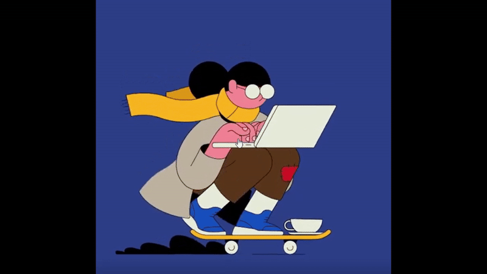

  

  

### 👩‍💻 About Me

- 🎓 4th-year **Computer Engineering** student
- 🛰️ Long-term **IT intern** at **Türksat** — System & Network Management (Linux, DNS, Nginx, Docker)
- 🛡️ Leading **[MetaDipGuard](https://github.com/MetaDipGuard)** — a decentralized protection platform built on Avalanche, using ERC-721 NFT certificates, zero-knowledge proofs and AI-based anomaly detection
- 🌱 Interested in blockchain security, applied cryptography, mobile development and machine learning

### 🚀 Featured Projects

- 🔐 **[steganografi_aes_ile](https://github.com/Kripto-Odev/steganografi_aes_ile)** — Two-layer data hiding with AES-256 encryption and PVD steganography
- 🎙️ **[Emotion Analysis App](https://github.com/Uygulama-Tasarimi-Projesi/app)** — Flutter app detecting emotions from text and voice recordings
- 🎬 **[AI Film App](https://github.com/Yapay-Zeka-Giris/AI_FILM_APP)** — Hybrid movie recommender (TF-IDF + KNN + K-Means) for individuals and groups
- 🧠 **[Psychological Risk Classification](https://github.com/Veri-Analizi-Proje-Odevi/High-Psychological-Risk-Classification-Based-on-Social-Media-Usage)** — ML model predicting risk from social media usage patterns

### 🛠️ Tech Stack

  

### 📊 Stats

  
  

  
  

